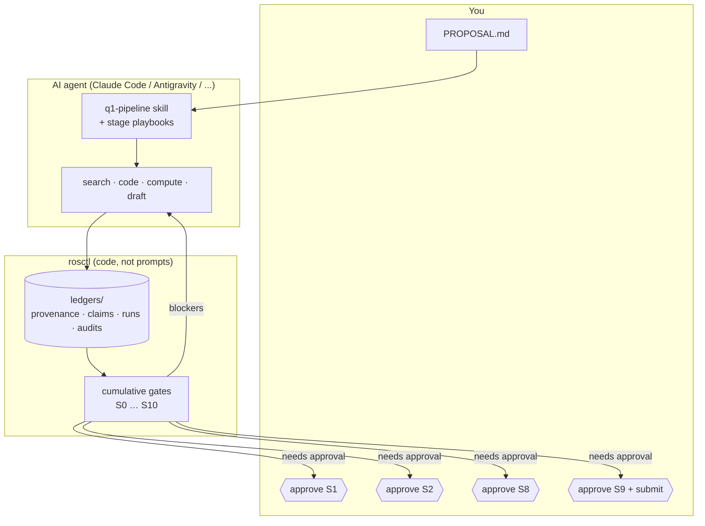

# Q1 Research OS

**An evidence-bound, gate-enforced research framework for AI coding agents (Claude Code, Antigravity
and any agent that reads `AGENTS.md`). You write one strong proposal; the agent does most of the
labour; machine-checked gates make sure nothing is fabricated, untraceable or overclaimed.**

[](https://github.com/Siam-449840/q1-research-os/actions/workflows/ci.yml)


-brightgreen)

---

## Contents

1. [Why this exists](#1-why-this-exists)
2. [What you get](#2-what-you-get)
3. [Quick start (5 minutes)](#3-quick-start-5-minutes)
4. [How it works](#4-how-it-works)
5. [The proposal: your one input](#5-the-proposal-your-one-input)
6. [The 11 stages and their gates](#6-the-11-stages-and-their-gates)
7. [`rosctl` command reference](#7-rosctl-command-reference)
8. [Ledgers: the audit trail](#8-ledgers-the-audit-trail)
9. [Project layout](#9-project-layout)
10. [Domain packs and adding your discipline](#10-domain-packs-and-adding-your-discipline)
11. [Using it with Claude Code, Antigravity and other agents](#11-using-it-with-claude-code-antigravity-and-other-agents)
12. [Optional ecosystem](#12-optional-ecosystem)
13. [The Q1 quality model](#13-the-q1-quality-model)
14. [Honest limits](#14-honest-limits)
15. [Repository layout](#15-repository-layout)
16. [Contributing, citation, license, credits](#16-contributing-citation-license-credits)

Documentation: [Setup Guide](docs/SETUP_GUIDE.md) · [Research Playbook](docs/PLAYBOOK.md) ·
[Proposal Guide](docs/PROPOSAL_GUIDE.md) · [Q1 Rubric](core/Q1_RUBRIC.md) ·
[Constitution](core/CONSTITUTION.md)

---

## 1. Why this exists

AI agents can now search literature, write analysis code and draft papers. Used naively, they also
invent references, round numbers that were never computed, tune on the test set, and write confident
prose about results that do not exist. "One-click paper" tools optimise for output, not for truth.

Q1 Research OS takes the opposite approach:

- **The agent does the labour** (searching, coding, computing, drafting, checking), roughly 90–95 %
  of the hours in a computational or secondary-data study.
- **Every output must be verifiable.** Numbers trace to result files and scripts; citations trace to
  passages; analyses trace to a protocol frozen before results were seen.
- **Rules are enforced by code, not by prompts.** `rosctl`, a dependency-free Python gatekeeper, checks
  each stage. The agent cannot pass a gate by asserting it did the work.
- **Judgement stays human.** Four gates (novelty, protocol freeze, review acceptance, submission) can
  only be approved by a person typing at a real terminal.

## 2. What you get

- **`rosctl`**: init, proposal linter, cumulative stage gates, human-only approvals, logged runs,
  data hashing, and verifiers: registry-checked references (exists / title matches / not retracted),
  exact-cell number provenance, machine-checked quotes, p-value recomputation, train/test leakage
  audit, independent re-computation and independent review. Stdlib only; 50 tests incl. a full
  S0→S10 end-to-end run with fault injection.
- **A research constitution** (`AGENTS.md` = `CLAUDE.md` = `GEMINI.md`) with 13 absolute rules
  (no fabrication, stop on failure, traceable numbers, independent re-computation, verified
  citations, frozen protocol, read-only raw data, legal access, human gates, no external actions,
  no overclaiming, honesty about limits).
- **Five agent skills**: `q1-pipeline` (orchestrator + 11 stage playbooks), `q1-proposal`,
  `q1-literature`, `q1-verify`, `q1-review`.
- **A Q1 rubric** (15 dimensions + desk-reject simulation) that the review panel must clear.
- **Domain packs**: `agriculture` (13 subfields: datasets, methods, baselines, pitfalls, reporting
  standards, venues), `software-engineering`, and a `_template` for any discipline.
- **A proposal template, a proposal-writing guide and a worked example** that passes the linter.
- **Optional curated skills** from K-Dense `scientific-agent-skills` and `claude-scholar`, pinned.

## 3. Quick start (5 minutes)

```bash
git clone https://github.com/Siam-449840/q1-research-os.git
cd q1-research-os && ./install.sh          # puts `rosctl` on your PATH (~/.local/bin)
rosctl doctor                              # checks git, uv and optional tools

rosctl init ~/research/my-paper --domain agriculture
cd ~/research/my-paper
# write PROPOSAL.md (see docs/PROPOSAL_GUIDE.md and examples/)
rosctl lint-proposal                       # iterate until there are no blockers
```

Then open the folder in **Claude Code** or **Antigravity** and say:

```
Use the q1-pipeline skill. Read AGENTS.md and PROPOSAL.md, run `rosctl status`, and work through the
stages. Stop at every human gate and give me the checkpoint in my communication language.
```

Full installation details: [docs/SETUP_GUIDE.md](docs/SETUP_GUIDE.md).

## 4. How it works



The working loop the agent follows (from the constitution):

```
rosctl status  →  read stages/<STAGE>_*.md  →  do the work (rosctl run -- …)  →  rosctl gate
     ↑                                                                              │
     └──────── fix blockers (max 3 tries, then ask) ◄──── FAIL ──────────────────────┤
                                                    PASS / NEEDS APPROVAL → checkpoint
```

Key design decisions:

| Decision | Why | Rejected alternative |
|---|---|---|
| Gates in code (`rosctl`) | agents can be persuaded; code cannot | prompt-only rules |
| Cumulative gates | later edits cannot silently break earlier guarantees (frozen protocol, raw-data hashes) | per-stage checks only |
| Approvals need an interactive terminal | stops an agent self-approving | approval flags in files |
| State in files, not chat | resume any time, switch agents, audit everything | conversation memory |
| Stdlib-only tooling | installs anywhere, nothing to break | framework with heavy dependencies |
| Per-project copies of rules and skills | a running study never changes under your feet | global, auto-updating rules |

## 5. The proposal: your one input

`PROPOSAL.md` has 13 sections: metadata (domain pack, ranked target journals, communication
language), contribution statement, problem and significance, state of knowledge and gap, research
questions with hypotheses (rival explanation, discriminating prediction, measurement, decision rule,
smallest effect size of interest), data sources (URL, version, license, coverage, access), methods and
validation, expected results and planned figures, threats to validity, ethics and sharing, definition
of done, constraints, and decisions reserved for the owner.

`rosctl lint-proposal` blocks placeholders, missing sections, hypotheses without decision rules,
data without URLs or licenses, methods without baselines, validation or robustness plans, and warns
on missing uncertainty plans, fewer than three planned figures and hype words.

Read **[docs/PROPOSAL_GUIDE.md](docs/PROPOSAL_GUIDE.md)**: ten principles, section-by-section advice,
weak → strong examples, and a pre-flight checklist. See the worked example in
[`examples/agriculture-rice-yield-transfer/`](examples/agriculture-rice-yield-transfer/PROPOSAL.md).

## 6. The 11 stages and their gates

| Stage | Agent does | `rosctl gate` blocks unless… | Human gate |
|---|---|---|---|
| **S0** Proposal | lint + PI-style critique | proposal has no lint blockers | |
| **S1** Literature & novelty | search protocol, logged multi-source search, snowballing, closest-work table, verified BibTeX, novelty verdict | `SEARCH_PROTOCOL.md`; ≥10 logged queries over ≥3 sources; ≥10 closest works classified none/partial/direct and present in `refs.bib`; verdict ≥150 words; **every bib entry registry-verified** by `rosctl verify-refs` (DOI resolves, title matches ≥0.85, not retracted) | **yes** |
| **S2** Protocol | pre-registered plan with decision rules | all protocol sections; hypotheses with decision rules; after approval, SHA-256 of the frozen part must never change | **yes** (freezes) |
| **S3** Data | download scripts, hashes, licenses, data card, sanity audit | `DATA_CARD.md`; every provenance row has URL, license, path under `data/raw/` and matching SHA-256 | |
| **S4** Analysis | tested, logged, leakage-aware pipeline + robustness | a successful logged run and a passing logged test run after the freeze; `analysis/tests/test_*`; non-empty `results/`; last run not failed; **split manifest** `results/splits/*.csv` shows no group in train and test of the same fold | |
| **S5** Re-computation | second, independent computation of key statistics | every protocol hypothesis covered; methods differ; values within tolerance | |
| **S6** Figures | one script per figure | every figure in the manifest with an existing script, colour-blind safe, raster ≥300 dpi | |
| **S7** Manuscript | evidence-bound draft in the golden order | required sections (incl. limitations, data/code availability, AI declaration); no placeholders; **every number** a correct rounding of the exact cell its locator names; **every citation** verified, with a claim-support row whose quote is checked against `literature/text/` when available; **every APA-style test result** recomputed (t, F, χ², r, z) | |
| **S8** Q1 review | independent reviewer panel + fix loop | four reviewer reports (editor, methods, domain, reproducibility); all 15 rubric dimensions ≥4 with evidence and a non-self reviewer; no open major issue | **yes** |
| **S9** Submission | cover letter, checklist, archive | cover letter; checklist fully ticked; journal quartile verified by the owner with source and date | **yes** (owner submits) |
| **S10** Revision | response to reviewers, new analyses | every reviewer comment has a response | |

Stage playbooks for the agent: [`skills/q1-pipeline/stages/`](skills/q1-pipeline/stages/).
What you should check before each approval: [docs/PLAYBOOK.md §4](docs/PLAYBOOK.md#4-stage-by-stage-what-to-check-before-you-approve).

## 7. `rosctl` command reference

| Command | What it does |
|---|---|
| `rosctl init <dir> [--domain D] [--extra-skills DIR]` | scaffold a project: constitution ×3, skills for every agent, domain pack, ledgers, git repo. Refuses to overwrite existing files |
| `rosctl lint-proposal [file]` | check the proposal; prints blockers, warnings and a 0–100 readiness score |
| `rosctl status` | stage progress and pending approvals |
| `rosctl gate [STAGE]` | run cumulative checks up to STAGE (default: current); record a pass or clear a stale one |
| `rosctl approve STAGE [--note]` | **human only**, S1/S2/S8/S9; needs an interactive terminal and a typed phrase; refused inside AI-agent sessions (environment markers, process ancestry); S2 freezes the protocol |
| `rosctl verify-refs` | **network**: resolve every `refs.bib` DOI at doi.org (Crossref, DataCite, …), compare titles, check OpenAlex retraction status, check URL-only entries; writes `ledgers/REFERENCE_VERIFICATION.csv` |
| `rosctl run -- <cmd …>` | run a command and append it to `ledgers/RUN_LOG.csv` (time, commit, exit code, duration) |
| `rosctl hash <paths…>` | print `path,sha256,size` rows for `DATA_PROVENANCE.csv` |
| `rosctl check refs\|numbers\|citations\|stats\|splits\|recompute\|review\|manuscript` | run one verifier on its own |
| `rosctl doctor` | check Python, git, uv and optional tools, with install hints |

Exit codes: `0` pass, `1` checks failed, `2` usage error, `3` approval refused (non-interactive).

How `check numbers` works: it extracts decimals, percentages and integers > 10 from the manuscript
(skipping years, the reference list, `code spans`, `[@cites]`, `[Source: …]`, URLs and
figure/table/section labels) and requires each to appear as a `value` in `NUMBER_PROVENANCE.csv`.
Each row's `locator` must resolve to exactly one place (`keycol=keyval:column` or `column` in CSV,
`$.path.0` in JSON, `line:N` in text) and the value must be a correct rounding of that cell.

How `check stats` works: it finds APA-style results (`t(23) = 2.45, p = .021`, `F(2, 57) = 4.10, p < .05`,
`χ2(1) = 3.84, p = .05`, `r(40) = .31, p = .045`, `z = 1.96, p = .05`), recomputes p from the statistic
and degrees of freedom (stdlib incomplete-beta/gamma; max error vs SciPy 8.5e-13 over 2,000 cases),
allows for rounding, and labels errors that flip significance as DECISION ERRORs.

## 8. Ledgers: the audit trail

| File | Columns | Filled in |
|---|---|---|
| `ledgers/SEARCH_LOG.csv` | date, source, query, filters, hits, screened, included, notes | S1 |
| `ledgers/REFERENCE_VERIFICATION.csv` | citekey, doi, url, status, title_similarity, registered_title, registered_year, bib_year, is_retracted, source, checked_at | S1, S7 (written by `rosctl verify-refs`) |
| `results/splits/*.csv` | fold, split, group | S4 (written by your CV code) |
| `literature/CLOSEST_WORK.csv` | citekey, title, year, doi_or_url, what_they_did, data, method, key_result, limitation, overlap_with_us, evidence_location | S1 |
| `ledgers/DATA_PROVENANCE.csv` | dataset_id, name, source_url, version_or_access_date, license, path, sha256, size_bytes, notes | S3 |
| `ledgers/RUN_LOG.csv` | timestamp_utc, command, git_commit, exit_code, duration_s, notes | S3–S10 (automatic) |
| `ledgers/RECOMPUTATION_AUDIT.csv` | stat_id, hypothesis_id, description, primary_value, primary_method, independent_value, independent_method, abs_tolerance, rel_tolerance, status | S5 |
| `ledgers/FIGURE_MANIFEST.csv` | figure_file, script, data_inputs, message, colorblind_safe, dpi | S6 |
| `ledgers/NUMBER_PROVENANCE.csv` | number_id, value, manuscript_location, results_file, locator, script, notes | S7 |
| `ledgers/CLAIM_SUPPORT.csv` | claim_id, manuscript_location, claim_text, citekey, evidence_location, evidence_quote, support_level, checked_by | S1, S7 |
| `ledgers/DECISION_LOG.csv` | timestamp_utc, stage, decision, options_considered, rationale, decided_by | all |
| `review/Q1_SCORECARD.csv` | dimension, score, evidence, reviewer | S8 |
| `review/ISSUES.csv` | issue_id, reviewer, severity, location, issue, action, status, resolution_note | S8 |
| `submission/JOURNAL_CHECK.csv` | journal, publisher, issn, quartile, quartile_source, checked_date, scope_fit, apc_or_route, ai_policy_url, owner_verified | S9 |

These files are also your best defence if a reviewer or editor questions a result.

## 9. Project layout

```
my-paper/
├── AGENTS.md  CLAUDE.md  GEMINI.md     constitution (identical copies)
├── PROPOSAL.md                         your brief
├── .claude/skills/  .agents/skills/  .agent/skills/
├── .ros/            state.json · domain/ · core/ (rubric, constitution)   ← rosctl only
├── literature/      SEARCH_PROTOCOL.md · CLOSEST_WORK.csv · NOVELTY_VERDICT.md · pdfs/ (git-ignored)
├── protocol/        PROTOCOL.md (frozen at S2; append-only Deviations)
├── data/            raw/ (read-only, git-ignored, hashed) · processed/ · DATA_CARD.md
├── analysis/        scripts · lib/ · tests/ · run_all.sh · uv.lock
├── results/         script outputs only
├── manuscript/      manuscript.md · figures/ · tables/
├── refs/            refs.bib
├── ledgers/         audit trail (section 8)
├── review/          scorecard · issues · reviewer reports · response letter
└── submission/      cover letter · checklist · journal check
```

## 10. Domain packs and adding your discipline

A domain pack is six Markdown files copied into each project as `.ros/domain/`:

| File | Content |
|---|---|
| `DOMAIN.md` | subfield map, what makes a paper Q1 in this field, search vocabulary, framing templates |
| `DATASETS.md` | open data sources by subfield, with access routes |
| `METHODS.md` | standard methods and the baselines reviewers expect |
| `PITFALLS.md` | leakage and validity traps, how reviewers detect them, the control to use |
| `REPORTING.md` | reporting guidelines (TRIPOD+AI, STROBE, PRISMA 2020, REFORMS, MIAPPE, ODD, …) |
| `JOURNALS.md` | venue map (quartiles deliberately omitted: verify at submission) |

**Included:** `agriculture` covers agronomy and crop modelling, climate impacts, remote sensing and
digital agriculture, soil, water and irrigation, breeding and genomics, plant protection, livestock,
fisheries and aquaculture, agricultural economics and policy, food systems, sustainability, and
agricultural AI/software. `software-engineering` covers empirical SE and research-software quality.

**Add your discipline:** copy `domains/_template/` to `domains/<your-field>/`, fill the six files
(with real, checkable URLs and no quartile claims), and open a pull request. Then
`rosctl init <dir> --domain <your-field>`.

## 11. Using it with Claude Code, Antigravity and other agents

| Agent | Rules file it reads | Skills folder | Notes |
|---|---|---|---|
| Claude Code | `CLAUDE.md` | `.claude/skills/` | optional MCP: `cp .mcp.json.example .mcp.json` |
| Antigravity | `AGENTS.md` / `GEMINI.md` | `.agents/skills/` (and `.agent/skills/`) | add MCP servers in its settings using the same commands |
| Gemini CLI, Codex, Cursor, others | `AGENTS.md` / `GEMINI.md` | point the agent at `.agents/skills/q1-pipeline/SKILL.md` | gates still enforced by `rosctl` |

Because all state lives in files, you can draft in one agent and review in another; this is
also an easy way to get the **independent** reviewers S5 and S8 require.

## 12. Optional ecosystem

| Component | Install | Role |
|---|---|---|
| paper-search-mcp | `./install.sh --with-tools` | multi-source search CLI + MCP (OpenAlex, Crossref, Semantic Scholar, arXiv, PubMed, CORE, DOAJ, …) |
| PaperQA2 (`pqa`) | `--with-tools` | cited question answering over your PDFs (needs an LLM key) |
| academic-refchecker, bibvet | `--with-tools` | reference existence and BibTeX metadata audits |
| zotero-mcp | `--with-tools` | Zotero library access for the agent |
| OpenAlex snowballing script | built in (`skills/q1-literature/scripts/`) | free forward/backward citation search, stdlib only |
| K-Dense scientific skills (23 curated) + claude-scholar (6 curated) | `./install.sh --with-extras` | statistics, visualisation, writing, peer review, citation management, geospatial, Bayesian modelling, anti-AI-style writing |

Versions are pinned in [`tools.lock`](tools.lock).

## 13. The Q1 quality model

[`core/Q1_RUBRIC.md`](core/Q1_RUBRIC.md) defines 15 dimensions (significance, novelty, positioning,
design validity, external validity, statistical rigour, baselines, robustness, reproducibility,
reporting standards, clarity, figures, limitations honesty, implications, journal fit) with anchors
for 3 ("major revision") and 5 ("accept"), a six-question **desk-reject simulation**, and the most
common reasons Q1 papers are rejected. S8 requires every dimension ≥ 4 with written evidence from
independent reviewers.

## 14. Honest limits

- **No guarantee of acceptance.** The framework removes avoidable reasons for rejection; significance,
  timing and reviewers remain outside anyone's control.
- **Designed for computational and secondary-data research.** Experimental data collection, ethics
  approvals and fieldwork are out of scope (the protocol, provenance and writing parts still help).
- **Heuristic checkers.** `check numbers` and `check stats` use pattern matching: numbers written as
  words, or statistics in non-APA formats, are not caught. A quote is machine-checked only when the
  source text is saved in `literature/text/`. Whether a cited passage *semantically* supports a claim
  is judged by reviewers, not by code.
- **Gates stop shortcuts, not determined fraud.** An agent could still fabricate a results file plus
  matching ledgers, or name a second method that is not truly independent. Defences: every result must
  come from a logged `rosctl run`, re-computation and review must come from fresh sessions, and the
  reproducibility reviewer re-runs the pipeline from a clean clone. Approval checks are defence in
  depth, not proof of humanity.
- **Third-party tools change.** Pinned versions reduce, but do not remove, breakage risk.
- **You remain the author.** Accountability, interpretation and submission are yours.

## 15. Repository layout

```
q1-research-os/
├── bin/rosctl.py               gatekeeper CLI (stdlib only)
├── core/                       CONSTITUTION.md · Q1_RUBRIC.md
├── skills/                     q1-pipeline (+ stages/S0…S10) · q1-proposal · q1-literature · q1-verify · q1-review
├── domains/                    agriculture · software-engineering · _template
├── templates/project/          what `rosctl init` copies (PROPOSAL, PROTOCOL, ledgers, manuscript, …)
├── examples/                   worked proposal(s)
├── docs/                       SETUP_GUIDE · PLAYBOOK · PROPOSAL_GUIDE
├── tests/                      unit tests for rosctl
├── install.sh                  installer (rosctl, optional tools, curated extra skills)
└── tools.lock                  pinned third-party versions
```

## 16. Contributing, citation, license, credits

- **Contributing:** see [CONTRIBUTING.md](CONTRIBUTING.md). Domain packs, new gate checks with tests,
  and worked examples are especially welcome.
- **Citation:** see [CITATION.cff](CITATION.cff). Please also declare the framework in your paper's
  AI-use statement.
- **License:** MIT.
- **Credits:** this framework orchestrates and builds on excellent open-source work, including
  [K-Dense scientific-agent-skills](https://github.com/K-Dense-AI/scientific-agent-skills),
  [claude-scholar](https://github.com/Galaxy-Dawn/claude-scholar),
  [PaperQA2](https://github.com/Future-House/paper-qa),
  [paper-search-mcp](https://github.com/openags/paper-search-mcp),
  [refchecker](https://github.com/markrussinovich/refchecker),
  [bibvet](https://github.com/dipta007/bibvet),
  [zotero-mcp](https://github.com/54yyyu/zotero-mcp) and the [OpenAlex](https://openalex.org/) API.
  Third-party components keep their own licenses and are fetched, not redistributed.
