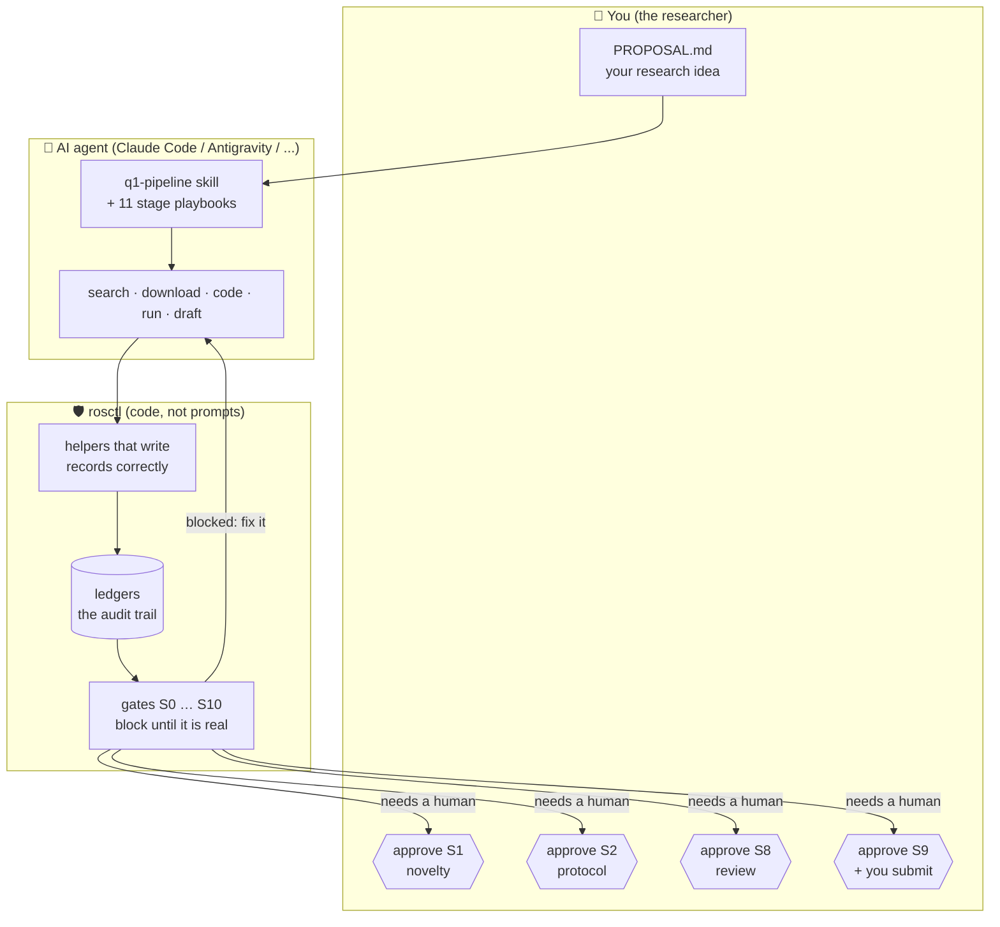

# Q1 Research OS

**A research framework for AI coding agents (Claude Code, Google Antigravity, and any agent that reads
`AGENTS.md`). You write one clear research proposal. The AI agent does most of the work: searching the
literature, downloading data, writing and running analysis code, making figures, drafting the paper. A
built-in checker called `rosctl` blocks every step until the work is real, traceable and honest, and only
you can approve the big decisions.**

[](https://github.com/Siam-449840/q1-research-os/actions/workflows/ci.yml)


-brightgreen)

> **Honest promise.** No tool can guarantee that a journal accepts your paper. What this framework does is
> remove the avoidable reasons for rejection: invented references, numbers nobody computed, data leakage,
> statistical mistakes, overclaiming, irreproducible code. It was tested against a list of **136 known
> failure modes** of AI-assisted research and on a [real pilot study](docs/PILOT_2026-11.md).

---

## Contents

**Part A — Understand it**
1. [What it is, in one picture](#1-what-it-is-in-one-picture)
2. [Who it is for, and what you still have to do](#2-who-it-is-for-and-what-you-still-have-to-do)
3. [Five ideas you need](#3-five-ideas-you-need)

**Part B — Use it**
4. [Install (10 minutes)](#4-install-10-minutes)
5. [Your first project, step by step](#5-your-first-project-step-by-step)
6. [Writing the proposal](#6-writing-the-proposal)
7. [The 11 stages: what the AI does, what you do, what is checked](#7-the-11-stages)
8. [Working with Claude Code](#8-working-with-claude-code)
9. [Working with Antigravity and other agents](#9-working-with-antigravity-and-other-agents)
10. [Every command, explained](#10-every-command-explained)
11. [Your approvals: the human checklist](#11-your-approvals-the-human-checklist)

**Part C — Trust it**
12. [How fabrication and mistakes are blocked](#12-how-fabrication-and-mistakes-are-blocked)
13. [Ledgers: the audit trail](#13-ledgers-the-audit-trail)
14. [Evidence: tests, pilot, platforms](#14-evidence-tests-pilot-platforms)
15. [Honest limits](#15-honest-limits)

**Part D — Reference**
16. [Project folder layout](#16-project-folder-layout)
17. [Domain packs and adding your discipline](#17-domain-packs-and-adding-your-discipline)
18. [Troubleshooting](#18-troubleshooting)
19. [FAQ](#19-faq)
20. [Repository layout, contributing, citation, license](#20-repository-layout-contributing-citation-license)

---

# Part A — Understand it

## 1. What it is, in one picture



The research goes through **11 stages** (S0 to S10). At the end of each stage `rosctl gate` checks the work.
If anything is missing, invented or inconsistent, the stage stays blocked and `rosctl next` tells the agent
exactly which command fixes it. Four stages can only be approved by you, typing in your own terminal.

```mermaid
flowchart LR
  S0[S0 proposal] --> S1[S1 literature<br/>& novelty]
  S1 -->|you approve| S2[S2 protocol<br/>frozen]
  S2 -->|you approve| S3[S3 data]
  S3 --> S4[S4 analysis]
  S4 --> S5[S5 independent<br/>re-computation]
  S5 --> S6[S6 figures]
  S6 --> S7[S7 manuscript]
  S7 --> S8[S8 independent<br/>review]
  S8 -->|you approve| S9[S9 submission<br/>package]
  S9 -->|you submit| S10[S10 revision]
```



## 2. Who it is for, and what you still have to do

It is for anyone doing **computational or secondary-data research** (statistics, machine learning,
modelling, meta-analysis, data mining) who wants an AI agent to do the heavy lifting without losing
scientific integrity. It works for beginners because every stage tells the agent what to do and tells you
what to check. It ships with a deep **agriculture** pack and a **software-engineering** pack, and a template
for any other discipline.

| The AI agent does | You do (and only you can) |
|---|---|
| literature searches, reference collection and verification | choose the research question and hypotheses |
| downloading data, documenting and hashing it | read the 3 closest papers yourself |
| writing, testing and running the analysis code | approve novelty (S1) and freeze the protocol (S2) |
| independent re-computation of key numbers | arrange independent reviewers (S8) |
| figures, tables and a full manuscript draft | revise the text, interpret the results |
| traceability records for every number and citation | verify the journal, run the similarity check, **submit** |

## 3. Five ideas you need

1. **The proposal is the steering wheel.** Everything the agent does traces back to `PROPOSAL.md`.
2. **Gates, not promises.** The agent cannot "say" it did something; `rosctl gate` checks the files.
3. **Everything leaves a record.** Searches, downloads, runs, numbers and citations are written to
   *ledgers* (CSV files) so anyone can audit them later.
4. **Second opinions are independent.** Key results are computed twice by different code; the paper is
   reviewed by someone other than the AI that wrote it.
5. **Big decisions are human.** `rosctl approve` refuses to run inside an AI session and asks you a short
   checklist of things only a human can confirm.

---

# Part B — Use it

## 4. Install (10 minutes)

**You need:** macOS, Linux or Windows (WSL2); Python 3.9 or newer; git; [uv](https://docs.astral.sh/uv/getting-started/installation/);
and an AI agent (Claude Code and/or Antigravity).

```bash
git clone https://github.com/Siam-449840/q1-research-os.git
cd q1-research-os
./install.sh          # puts `rosctl` on your PATH (~/.local/bin)
rosctl doctor         # shows what is installed and how to install what is missing
```

If `rosctl` is "command not found", add `export PATH="$HOME/.local/bin:$PATH"` to `~/.zshrc` (or `~/.bashrc`)
and open a new terminal.

**Optional extras:**

```bash
./install.sh --with-tools     # literature tools: paper-search, PaperQA2, refchecker, bibvet, zotero-mcp
./install.sh --with-extras    # 29 curated scientific skills (statistics, writing, review, ...), pinned versions
./install.sh --global-skills  # make the q1-* skills available in every Claude Code project
```

After `--with-extras`, add the line it prints (`export ROS_EXTRA_SKILLS=...`) to your shell profile.
More detail: [docs/SETUP_GUIDE.md](docs/SETUP_GUIDE.md).

## 5. Your first project, step by step

**Step 1 — Create the project** (one folder per paper):

```bash
rosctl init ~/research/my-paper --domain agriculture     # or software-engineering, or _template
cd ~/research/my-paper
```

**Step 2 — Write `PROPOSAL.md`.** Open the file; replace every `<placeholder>`. Read
[section 6](#6-writing-the-proposal) and the [worked example](examples/agriculture-rice-yield-transfer/PROPOSAL.md).
Check it as often as you like:

```bash
rosctl lint-proposal        # aim for no blockers and a score of 90+
```

**Step 3 — Start the agent inside the project folder** and give it the start prompt:

```
Use the q1-pipeline skill. Read AGENTS.md and PROPOSAL.md, run `rosctl status`, and work through the
stages. Use the rosctl helpers instead of writing ledger rows by hand. Stop at every human gate and give
me the checkpoint in my communication language.
```

**Step 4 — Let it work; read the checkpoints.** After every stage the agent reports *Done / Verified /
Not verified / Needs you*. Read "Not verified" first.

**Step 5 — Approve the gates yourself** when asked, in your own terminal (not the agent's):

```bash
rosctl approve S1      # then S2, S8, S9 when the agent says the checks pass
```

**Step 6 — Revise, then submit personally.** The agent prepares the cover letter, checklist and archive;
you verify the journal, run your institution's similarity check and submit.

At any time:

```bash
rosctl status     # where am I?
rosctl next       # what is blocking, and which command fixes it?
```

## 6. Writing the proposal

The proposal has 13 sections. The most important rules:

1. **One-sentence contribution.** "We show that ___, which matters because ___."
2. **Neutral, testable questions.** Not "Why does X increase yield?" but "What is the effect of X on yield?"
   (`rosctl` blocks questions that assume their answer).
3. **Each hypothesis has five lines:** rival explanation, discriminating prediction, measurement,
   **decision rule** (what result counts as support), smallest effect that matters.
4. **Data you have opened:** URL, version, licence, coverage, unit, access.
5. **Validation that matches your data:** spatial, temporal or grouped data need grouped validation.
6. **Strong baselines, planned figures, threats to validity, what you will publish if it fails.**
7. **Section 12 lists what the agent must always ask you.**

Full guide with weak-to-strong examples: [docs/PROPOSAL_GUIDE.md](docs/PROPOSAL_GUIDE.md).

## 7. The 11 stages

| Stage | The AI agent does | You do | `rosctl gate` checks |
|---|---|---|---|
| **S0** Proposal | lints and critiques the proposal, suggests sharper framings | write it, accept or reject edits | no placeholders, falsifiable hypotheses with decision rules, data with URL + licence, validation and baselines, neutral questions, agent permission file intact |
| **S1** Literature | `rosctl search` (logged, raw output kept), counter-evidence and grey/regional searches, `rosctl add-ref` (verified references), `rosctl fetch-text`, closest-work table, novelty verdict | read the 3 closest papers, **approve S1** | ≥10 queries over ≥3 sources, counter-evidence and grey-literature searches, every reference exists, title and metadata match, not retracted, verdict with contrary evidence and search limitations, no prompt injection in sources |
| **S2** Protocol | drafts the pre-registered analysis plan | check it tests what you care about, **approve S2** (freezes it) | all sections, decision rules, 24 method rules (e.g. ANOVA needs sum-of-squares type, ML needs seeds and baselines, causal questions need identification) |
| **S3** Data | `rosctl fetch` (download, hash, provenance, read-only), data card, schema, cleaning log | confirm licences and large downloads | hashes match, licences recorded, units/ranges/dates valid, personal data needs an ethics note, every cleaning step logged |
| **S4** Analysis | pinned environment, `rosctl verify-deps`, tested leakage-free code, runs via `rosctl run` | check results are plausible | logged successful runs and tests, split manifest shows no leakage, no fake-data fallbacks or silenced errors, outputs produced by logged runs and not stale, tests locked |
| **S5** Re-computation | computes key statistics a second, independent way | — | every hypothesis covered, values agree within tolerance |
| **S6** Figures | one script per figure, colour-blind safe | judge each figure's message | script exists, produced by a logged run, error-bar type declared, ≥300 dpi for raster |
| **S7** Manuscript | drafts in the right order; `rosctl provenance --apply`, `rosctl cite-number`, `rosctl log-ai` | revise voice and interpretation | every number traced to an exact cell, every citation verified with a matching quote, p-values recomputed, misleading language blocked, all hypotheses reported, limitations specific, AI use declared |
| **S8** Review | independent reviewer panel (editor, methods, domain, reproducibility) and fixes | read reviews, answer checklist, spot-check samples, **approve S8** | four reports, at least one reviewer not the drafting model, all 15 rubric scores ≥4 with evidence, no open major issue |
| **S9** Submission | cover letter, formatting, checklist, archive | verify journal, similarity check, **approve S9**, **submit** | checklist ticked, guide for authors downloaded, journal verified by you |
| **S10** Revision | response to reviewers, new analyses | decide disagreements, submit | every comment answered, every claimed change really in the manuscript |

Agent-facing details for each stage: [`skills/q1-pipeline/stages/`](skills/q1-pipeline/stages/).
What to check before each approval: [docs/PLAYBOOK.md](docs/PLAYBOOK.md).

## 8. Working with Claude Code

1. Open a terminal **in the project folder** and run `claude` (or open that folder in the Claude desktop app).
   This matters: Claude Code applies the project's permission rules (`.claude/settings.json`) only when the
   session starts in that folder. Started from a parent folder, it still reads the rules and skills but
   the protection against editing raw data and self-approval is not active.
2. Claude Code reads `CLAUDE.md` and finds the five skills in `.claude/skills/` automatically.
3. Optional literature servers: `cp .mcp.json.example .mcp.json` (needs `./install.sh --with-tools`).
4. Use the start prompt from section 5.

What the permission file does: it denies the agent editing `data/raw/`, `.ros/` and the ledgers that
`rosctl` writes, denies `rosctl approve`, `relock-tests` and `ack-injection`, and asks you before any
package installation or `git push`.

## 9. Working with Antigravity and other agents

**Antigravity:** open the project folder as the workspace. It reads `AGENTS.md` / `GEMINI.md` and the
skills in `.agents/skills/`. Antigravity also loads any global plugin rules you have installed; the project
constitution says it wins on conflict. Add the optional MCP servers in Antigravity's settings with the
same commands as `.mcp.json.example`. Start prompt:

```
Follow AGENTS.md. Use the q1-pipeline skill in .agents/skills. Start with `rosctl status` and continue from
the current stage, using the rosctl helpers; stop at each human gate with a checkpoint.
```

**Gemini CLI, Codex, Cursor and others:** point the agent at `AGENTS.md` and
`.agents/skills/q1-pipeline/SKILL.md`. The gates are enforced by `rosctl`, not by the agent.

Because all state is in files, you can switch agents at any time, for example draft with one and
review with another (which is exactly what S8 needs).

## 10. Every command, explained

**Navigation**

| Command | What it does |
|---|---|
| `rosctl init <dir> --domain D` | create a project (never overwrites existing files) |
| `rosctl status` | which stage you are in and which approvals are pending |
| `rosctl next` | current blockers grouped by the exact command that fixes them |
| `rosctl gate [STAGE]` | run all checks up to that stage; record a pass or clear stale passes |
| `rosctl doctor` | check installed tools |

**Helpers that write records correctly (use these instead of editing CSV files)**

| Command | What it does | Refuses when |
|---|---|---|
| `rosctl search "<query>" [--source S] [--purpose P] [--year-from Y]` | searches OpenAlex (built in) or any paper-search source, saves the raw result, logs it; `--purpose` = `main`, `counter-evidence`, `grey/regional`, `snowball` | the search fails (nothing is logged) |
| `rosctl add-ref <DOI> [<DOI> ...]` | gets the official BibTeX, gives it a stable citekey, verifies it immediately | the DOI does not resolve (never added) |
| `rosctl fetch-text <citekey> ...` | saves the source text with an honest `ACCESS:` line (full text from your legal PDF in `literature/pdfs/<key>.pdf`, otherwise the abstract) | no text is legally available |
| `rosctl fetch <URL> --id D1 --license "..." [--max-mb N]` | downloads into `data/raw/D1/`, hashes it, records provenance, makes it read-only | licence missing, file exists, file too large |
| `rosctl provenance [--apply]` | finds which results cell each manuscript number came from; `--apply` records only unambiguous matches | ambiguous (`CHOOSE`) or no source (`MISSING`) |
| `rosctl cite-number <value> <file> <locator> --at <place>` | records a chosen number source after checking it | locator or rounding does not match |
| `rosctl log-ai --tool --model --purpose` | records AI assistance for the disclosure statement | — |
| `rosctl run -- <command>` | runs your analysis and logs it (time, commit, exit code, outputs) | — (a failed run blocks the gate) |
| `rosctl hash <paths>` | prints file hashes for manual provenance | — |

**Verification**

| Command | What it does |
|---|---|
| `rosctl lint-proposal` | check the proposal (0–100 readiness score) |
| `rosctl verify-refs` | re-verify every reference against registries (doi.org, OpenAlex retraction status) |
| `rosctl verify-deps` | check every declared package exists and is not brand new (anti-"slopsquatting") |
| `rosctl check <name>` | run one check: `refs`, `numbers`, `citations`, `stats`, `splits`, `recompute`, `review`, `manuscript`, `language`, `code`, `schema`, `outputs`, `environment`, `ai-log`, `cleaning`, `quotes`, `metric-split`, `reviewers`, `permissions` |

**Human only (refused inside AI sessions)**

| Command | What it does |
|---|---|
| `rosctl approve S1\|S2\|S8\|S9 [--note]` | your approval, with a short checklist; S2 freezes the protocol; S8 shows a random spot-check |
| `rosctl relock-tests --reason "..."` | accept changed tests after S4 |
| `rosctl ack-injection <file>` | confirm you inspected a source flagged for hidden instructions |

## 11. Your approvals: the human checklist

`rosctl approve` asks you to type `yes` to a short list of things only a human can confirm (26 items in
total), for example:

- **S1:** "I read the three closest papers in full text myself." "Novelty rests on evidence, not on missing search hits."
- **S2:** "Every protocol constant (doses, varieties, seasons, units) comes from cited official sources."
- **S8:** "No overstatement: no may→does, lab→field, correlation→causation." "I can explain and defend every analysis myself." Plus a random sample of 3 numbers and 3 claims you must check against the source.
- **S9:** "Ethics, funding and data-availability statements are true." "No confidential material was sent to AI services that policy forbids."

Typing `yes` means you take responsibility. The checklist is only as strong as your honesty.

---

# Part C — Trust it

## 12. How fabrication and mistakes are blocked

The framework maps **136 known failure modes** of AI-assisted research to concrete controls
([full matrix](docs/ERROR_CONTROL_MATRIX.md)): 58 automated, fail-closed checks and 26 human checklist
items. A test fails if any of the 136 lacks a control. Examples:

| Risk | What stops it |
|---|---|
| Invented or wrong references | every reference resolved at doi.org; title, year and first author must match; retracted papers blocked |
| Citing a paper for something it does not say | the quote must be found in the saved source text; reviewers and your spot-check confirm meaning |
| Numbers nobody computed | every number in the paper must be a correct rounding of one exact cell of a results file produced by a logged run |
| Results changed after the fact | outputs are fingerprinted per run; stale or hand-edited files block; tests are locked after S4 |
| Data leakage | split manifests must show no group (site, year, country) in both training and test |
| Statistical mistakes | p-values recomputed from the reported statistics; ANOVA, mixed-model, ML and causal designs must state their safeguards |
| Fake data when a file is missing | analysis code with synthetic-data generators or silenced errors is blocked |
| Hallucinated software packages | packages verified on PyPI/CRAN before installation |
| Misleading language | "proves", "highly significant", unhedged "first study", ± without SD/SE are blocked |
| Hidden instructions in PDFs | sources scanned; flagged files blocked until you inspect them |
| The AI approving its own work | approvals refused in AI sessions; independent reviewers required |

## 13. Ledgers: the audit trail

| File | What it records | Written by |
|---|---|---|
| `ledgers/SEARCH_LOG.csv` + `literature/search_raw/` | every search and its raw result | `rosctl search` |
| `refs/refs.bib` + `ledgers/REFERENCE_VERIFICATION.csv` | references and their registry check | `rosctl add-ref`, `verify-refs` |
| `literature/text/` | source texts with ACCESS line | `rosctl fetch-text` |
| `literature/CLOSEST_WORK.csv` | the 10+ closest studies and their overlap | agent |
| `ledgers/CLAIM_SUPPORT.csv` | for each citation: location, quote, support level | agent |
| `ledgers/DATA_PROVENANCE.csv` | each dataset: URL, licence, hash | `rosctl fetch` |
| `data/SCHEMA.csv`, `ledgers/DATA_CLEANING_LOG.csv` | units, ranges, cleaning steps | agent / scripts |
| `ledgers/RUN_LOG.csv`, `ledgers/OUTPUT_MANIFEST.jsonl` | every run and the files it produced | `rosctl run` |
| `ledgers/NUMBER_PROVENANCE.csv` | each manuscript number → results cell | `rosctl provenance`, `cite-number` |
| `ledgers/RECOMPUTATION_AUDIT.csv` | key numbers computed twice | analysis scripts |
| `ledgers/AI_USAGE_LOG.csv` | AI tools, models, dates, purposes | `rosctl log-ai` |
| `ledgers/DEPENDENCY_VERIFICATION.csv` | package checks | `rosctl verify-deps` |
| `ledgers/DECISION_LOG.csv` | every choice between alternatives | agent |
| `review/` | reviewer reports, scorecard, issues, responses | reviewers |
| `submission/JOURNAL_CHECK.csv` | journal facts you verified | you |

If an editor questions a result, these files are your answer.

## 14. Evidence: tests, pilot, platforms

- **Tests:** 96 automated tests (unit, control, end-to-end with fault injection), green on Python 3.9, 3.12
  and 3.13 in CI. Mutation testing: disabling any check makes the tests fail.
- **Pilot study** ([report](docs/PILOT_2026-11.md)): a real cross-country cereal-yield question run from
  proposal to manuscript draft in about 48 minutes of agent time. Helpers wrote 80+ records that previously
  had to be hand-written; the data-schema check caught a genuine error in public FAO data; the pilot also
  found and fixed three framework bugs. The human gates (S1, S2, S8, S9) were left for the owner, by design.
- **Claude Code:** rules (`CLAUDE.md`) and the five skills were loaded and invoked at runtime; the approval
  guard refused. Project permissions apply only when Claude Code is started inside the project folder.
- **Antigravity (`agy` CLI):** rules and the five skills discovered; the agent named the correct helper
  commands and the prompt-injection rule. Running commands from headless Antigravity was not verified.

## 15. Honest limits

- **No acceptance guarantee.** Significance, timing and reviewers are outside anyone's control.
- **Meaning is judged by people.** Whether a cited passage truly supports a claim, or whether a method fits the
  question, is checked by reviewers and by your checklist, not by code. 31 of the 136 risks keep a high
  residual risk for this reason (see the matrix).
- **Pattern-based checks have gaps:** numbers written as words, non-standard statistics notation, new kinds
  of hidden instructions.
- **Local files can be forged by someone with full shell access.** The protection is agent permissions and
  the rules, not cryptography.
- **Time saved has not been measured against a manual baseline.** The pilot measured agent time only.
- **Computational research only.** Field and lab data collection are outside the scope.

---

# Part D — Reference

## 16. Project folder layout

```
my-paper/
├── PROPOSAL.md                          your research brief
├── AGENTS.md  CLAUDE.md  GEMINI.md      the rules every agent follows (identical copies)
├── .claude/settings.json                Claude Code permission rules
├── .claude/skills/ .agents/skills/ .agent/skills/   the five q1-* skills (+ optional extras)
├── .ros/                                state, domain pack, rubric, controls (rosctl only)
├── literature/   SEARCH_PROTOCOL.md · search_raw/ · text/ · CLOSEST_WORK.csv · NOVELTY_VERDICT.md · pdfs/
├── protocol/     PROTOCOL.md (frozen at S2; changes only under "Deviations")
├── data/         raw/ (read-only, hashed) · processed/ · DATA_CARD.md · SCHEMA.csv
├── analysis/     scripts · tests/ · recompute/
├── results/      outputs of logged runs only · splits/
├── manuscript/   manuscript.md · figures/ · tables/
├── refs/         refs.bib
├── ledgers/      the audit trail (section 13)
├── review/       reviewer reports · scorecard · issues · response letter
└── submission/   cover letter · checklist · journal check · guide for authors
```

## 17. Domain packs and adding your discipline

Each pack has six files copied into `.ros/domain/`: `DOMAIN.md` (subfields, what makes work Q1, search
vocabulary), `DATASETS.md`, `METHODS.md` (expected baselines), `PITFALLS.md`, `REPORTING.md` (reporting
guidelines such as TRIPOD+AI, STROBE, PRISMA 2020), `JOURNALS.md` (no quartile claims: verify yourself).

Included: **agriculture** (13 subfields from agronomy to agricultural economics and AI) and
**software-engineering**. To add yours: copy `domains/_template/` to `domains/<your-field>/`, fill the six
files with real, checkable information, and open a pull request.

## 18. Troubleshooting

| Problem | Fix |
|---|---|
| `rosctl: command not found` | add `~/.local/bin` to PATH, open a new terminal |
| `approve` says REFUSED | run it in your own terminal app, not the agent's |
| "not verified against a registry" | `rosctl verify-refs` (needs internet) |
| "no saved source text" | `rosctl fetch-text <citekey>` |
| "has no row in NUMBER_PROVENANCE" | `rosctl provenance --apply`, then `cite-number` for `CHOOSE` items |
| "not produced by a logged run" / "STALE" | regenerate with `rosctl run -- <script>` |
| "PROTOCOL.md changed after freeze" | restore it; record changes only under "Deviations" |
| "sha256 mismatch" | raw data changed; restore it from the source |
| "dependency not verified" | `rosctl verify-deps` before installing |
| "possible prompt injection" | read the file yourself, then `rosctl ack-injection <file>` |
| Agent edits raw data despite permissions | start Claude Code inside the project folder |
| Anything else | `rosctl next` groups every blocker with its fix |

More: [docs/SETUP_GUIDE.md](docs/SETUP_GUIDE.md#7-troubleshooting).

## 19. FAQ

**How much work does the AI really do?** In the pilot, the agent did all searching, downloading, coding,
re-computation, figures and drafting, and the helpers wrote the records. The remaining human work is the
research question, reading key papers, four approvals, arranging independent review and submitting.
"Hours saved" against a manual baseline has not been measured yet.

**Can I use it for my discipline?** Yes, the pipeline is discipline-agnostic. Use `--domain _template` and
fill your own pack for the best guidance.

**Does it work offline?** The gates work offline. Searching, adding references, downloading and verifying
need internet.

**Can I skip a stage?** No. Gates are cumulative. If a check truly does not apply, record why in
`ledgers/DECISION_LOG.csv` and open an issue.

**Is my data sent anywhere?** Only to the services you call (OpenAlex, doi.org, Crossref, PyPI, data
sources). Never upload confidential data or manuscripts to AI services your institution or journal forbids.

## 20. Repository layout, contributing, citation, license

```
q1-research-os/
├── bin/          rosctl.py (gates, commands) · rosqa.py (content checks) · rosrefs.py (references, packages)
│                 rosstats.py (p-value engine) · rosauto.py (helpers) · gen_matrix_doc.py
├── core/         CONSTITUTION.md · Q1_RUBRIC.md · CONTROLS.csv · ERROR_CONTROLS.csv
├── skills/       q1-pipeline (+ stages S0…S10) · q1-proposal · q1-literature · q1-verify · q1-review
├── domains/      agriculture · software-engineering · _template
├── templates/    the project skeleton copied by `rosctl init`
├── examples/     worked proposal
├── docs/         SETUP_GUIDE · PLAYBOOK · PROPOSAL_GUIDE · ERROR_CONTROL_MATRIX · PILOT_2026-11
├── tests/        96 tests
├── install.sh · tools.lock · RELEASE_POLICY.md · CHANGELOG.md · CITATION.cff · LICENSE
```

- **Contributing:** [CONTRIBUTING.md](CONTRIBUTING.md). Never weaken a check to make something pass;
  open an issue about the false positive instead. Releases follow [RELEASE_POLICY.md](RELEASE_POLICY.md).
- **Citation:** [CITATION.cff](CITATION.cff); also declare the framework in your AI-use statement.
- **License:** MIT. Built on open-source work including K-Dense scientific-agent-skills, claude-scholar,
  PaperQA2, paper-search-mcp, refchecker, bibvet, zotero-mcp, OpenAlex, Crossref and doi.org.
