# Research Playbook

How to run a computational / secondary-data study from idea to Q1 submission with Q1 Research OS,
and what **you**, the accountable researcher, must look at along the way. The agent-facing,
step-by-step instructions live in `skills/q1-pipeline/stages/`; this playbook is the human view.

---

## 1. The philosophy in five lines

1. **AI does the labour, humans own the judgement.** The agent searches, codes, computes and drafts;
   you decide the question, approve the novelty verdict, freeze the protocol, accept the review and submit.
2. **Nothing is trusted, everything is traced.** Numbers trace to result files, results to scripts,
   scripts to a frozen protocol, citations to passages you could open.
3. **Gates, not good intentions.** Quality rules are enforced by `rosctl`, which an agent cannot talk
   its way past. Approvals require a human at a real terminal.
4. **Second opinions are independent.** Key numbers are re-computed by a different route; reviews are
   done by fresh agents that did not write the paper.
5. **Honesty is a feature.** Negative results, deviations and limitations are reported. A paper that
   hides weaknesses is fragile; a paper that addresses them is strong.

No framework can guarantee acceptance. This one aims to make sure a Q1 journal has **no legitimate
reason to reject** the work: no fabrication, no leakage, no overclaiming, no missing comparison.

## 2. Who does what

| Stage | Agent | You (owner) | Human gate |
|---|---|---|---|
| S0 Proposal | lints, critiques, suggests sharper framings | write and decide | – |
| S1 Literature | protocolled search, snowballing, closest-work table, novelty verdict | read the 3–5 closest papers; judge overlap | **approve S1** |
| S2 Protocol | drafts the pre-registered analysis plan | check it tests what you care about | **approve S2** (freezes it) |
| S3 Data | download scripts, hashes, data card, sanity audit | confirm licenses and any large downloads | – |
| S4 Analysis | tested pipeline, baselines, robustness | spot-check outputs for plausibility | – |
| S5 Re-computation | independent second computation | – | – |
| S6 Figures | scripted, colour-blind safe figures | judge whether each figure carries its message | – |
| S7 Manuscript | evidence-bound draft in the right order | revise voice, emphasis, interpretation | – |
| S8 Review | independent reviewer panel, fix loop | read reviews and the diff of fixes | **approve S8** |
| S9 Submission | cover letter, checklist, archive | verify journal quartile, run similarity check, **submit** | **approve S9** |
| S10 Revision | response letter, new analyses | decide disagreements; **submit** | – |

## 3. Lifecycle at a glance

```mermaid
flowchart LR
  P[PROPOSAL.md] --> S0[S0 lint]
  S0 --> S1[S1 literature<br/>& novelty]
  S1 -->|owner approves| S2[S2 protocol<br/>freeze]
  S2 -->|owner approves| S3[S3 data<br/>provenance]
  S3 --> S4[S4 analysis<br/>tested & logged]
  S4 --> S5[S5 independent<br/>re-computation]
  S5 --> S6[S6 figures]
  S6 --> S7[S7 evidence-bound<br/>manuscript]
  S7 --> S8[S8 adversarial<br/>Q1 review]
  S8 -->|owner approves| S9[S9 submission<br/>package]
  S9 -->|owner submits| S10[S10 revision]
  S8 -. major issue .-> S4
  S1 -. reframe .-> P
```

## 4. Stage by stage: what to check before you approve

### S0: Proposal
- Read the agent's critique. Did it challenge a "method-on-region" contribution?
- Accept or reject each proposed edit; never let the agent silently change your question.
- Your `PROPOSAL.md` is the steering wheel: see [PROPOSAL_GUIDE.md](PROPOSAL_GUIDE.md).

### S1: Literature and novelty (gate)
Before `rosctl approve S1`:
- Open `literature/CLOSEST_WORK.csv`. Read the three closest papers yourself (at least abstract,
  methods and results).
- Any `direct` overlap? Then reframe, or justify precisely how you differ.
- Does `NOVELTY_VERDICT.md` cite evidence (citekeys and locations), not just assert?
- Was the search broad (≥ 3 sources, synonyms, snowballing, recent preprints)? See `SEARCH_LOG.csv`.
- `ledgers/REFERENCE_VERIFICATION.csv` shows every reference `verified` against its registry (the gate
  already blocks fabricated, mis-titled and retracted entries; skim the registered titles anyway).
- Red flags: novelty based on "zero search hits"; references you cannot open; a verdict that never
  mentions a competitor.

### S2: Protocol (gate; this freezes the plan)
Before `rosctl approve S2`:
- Each hypothesis has a decision rule you would accept even if it goes against you.
- Validation matches the data (spatial / temporal / grouped). No random K-fold for the headline result.
- Baselines are strong and tuned with equal effort.
- Exploratory analyses are labelled as such.
- After approval, the protocol's SHA-256 is recorded. Any edit above `## Deviations` fails every
  later gate. Deviations are allowed, but they are dated, justified and reported.

### S3: Data
- Glance at `ledgers/DATA_PROVENANCE.csv`: every file has a source URL, license and hash.
- Read `data/DATA_CARD.md` and the data audit in `results/data_audit/`. Do units and ranges make sense
  to you as a domain expert? (The agent knows statistics; you know what a plausible yield is.)

### S4: Analysis
- Plausibility check: are effect sizes and accuracies physically or biologically believable? Too good
  to be true usually means leakage.
- `results/splits/` shows which sites/years/groups were held out in each fold; the gate blocks any
  group that appears in both train and test.
- `ledgers/RUN_LOG.csv` shows every run, including failures. Failures fixed at the root are good
  evidence of rigour; failures papered over are not allowed.

### S5: Re-computation
- `ledgers/RECOMPUTATION_AUDIT.csv` shows each key statistic computed twice by different methods. A
  mismatch that was found and fixed is a success of the system: note it.

### S6: Figures
- For each figure, can you state its one message in one sentence without reading the text?
- Uncertainty shown? Colour-blind safe? Readable at print size?

### S7: Manuscript
- Read it as the person who will defend it at a conference. Is the contribution clear in the title,
  abstract and the last paragraph of the Introduction?
- Revise the voice and the emphasis; that is your job. Every number you add or change needs a
  provenance row (`rosctl check numbers` will tell you).

### S8: Review (gate)
Before `rosctl approve S8`:
- Read every reviewer report in `review/`. Were reviewers independent (fresh sessions)?
- Every major issue is resolved (with a diff) or justified (with an argument you agree with).
- Every rubric dimension is ≥ 4 with evidence you find convincing.

### S9: Submission (gate)
Before `rosctl approve S9`:
- Verify quartile and indexing yourself on SCImago / JCR for the right subject category, and the
  journal's legitimacy. Record it in `submission/JOURNAL_CHECK.csv`.
- Run the institutional similarity check (Turnitin / iThenticate).
- Read the cover letter as if you were the editor.
- **You submit.** The agent never submits.

### S10: Revision
- Decide where to agree and where to respectfully disagree. Disagreement needs evidence.
- New analyses requested by reviewers go through S4–S6 again, logged as deviations.

## 5. What Q1 means: the 15-dimension rubric

Read [`core/Q1_RUBRIC.md`](../core/Q1_RUBRIC.md). The most frequent reasons strong-looking papers get
rejected:

1. Significance asserted, not demonstrated ("so what?").
2. A reviewer knows a paper that already did it (S1 exists to prevent this).
3. Leakage or optimistic validation (random splits on dependent data).
4. Weak or untuned baselines.
5. Causal language on correlational evidence.
6. Not reproducible: no code, no data path, no environment.
7. Statistics without effect sizes, uncertainty or multiplicity control.
8. Discussion that repeats results instead of interpreting them.

## 6. Writing a Q1 paper

**Golden order:** Methods → Results → Discussion → Introduction → Conclusion → Abstract → Title.
You write what you did before you sell it.

**Paragraph discipline:** one idea per paragraph; first sentence states it; the rest supports it.

**The Introduction funnel (4–6 paragraphs):** stakes (quantified) → what is known → the evidenced gap →
our contributions (2–4 bullets) → roadmap.

**Results:** one subsection per research question; the first sentence answers the question; numbers
with uncertainty; no interpretation.

**Discussion:** principal findings → comparison with the closest work (agree/disagree and why) →
mechanisms → implications bounded by evidence → limitations with direction of bias → future work.

**Style:** precise verbs ("reduced RMSE by 12% [95% CI 8–16%]", not "greatly improved"); consistent
terms; past tense for what you did, present for established facts; no hype words; define every
abbreviation once.

## 7. Integrity, AI use and disclosure

- Never let the agent fabricate. If information is missing, it must write `[VERIFY: ...]`, which
  blocks the gates until resolved.
- Check your target journal's AI policy. Most require a declaration; AI tools cannot be authors.
- Example declaration (adapt to what actually happened):

  > During this work the authors used <tool names and versions> to assist with literature search,
  > code development, statistical re-computation checks and language editing. All analyses were
  > executed from version-controlled scripts; all references were verified against their sources. The
  > authors reviewed and edited all content and take full responsibility for the publication.

- Similarity checking, authorship decisions, ethics approvals and submission are always human tasks.

## 8. Working with the agent day to day

- **Start of every session:** "Run `rosctl status` and continue from the current stage." The state
  lives in files, not in the chat, so you can stop and resume any time, or switch between Claude Code
  and Antigravity.
- **Checkpoints:** after every gate the agent reports Done / Verified / Not verified / Needs you.
  Read the "Not verified" part first.
- **Long tasks:** one stage per session is a good rhythm. Start a fresh session when the context gets
  long; the files carry the memory.
- **Independence:** for S5 (fresh-session re-implementation) and S8 (reviewers), use a new session or a
  different model on purpose.
- **When it is stuck:** after 3 failed attempts on the same blocker the agent must stop and ask. Give
  it the missing information or make the decision.
- **Model choice:** use your strongest model for S1, S2, S7 and S8 (judgement-heavy); faster models
  are fine for downloads, formatting and routine scripts, with the small-model safety net in the
  constitution.

## 9. A realistic 12-week plan (about 15 h/week)

| Week | Stages | Your main task |
|---|---|---|
| 1 | S0 | Write and sharpen the proposal |
| 2–3 | S1 | Read the closest papers; approve novelty |
| 3 | S2 | Approve the protocol |
| 4 | S3 | Confirm data and licenses |
| 5–7 | S4–S5 | Plausibility checks |
| 8 | S6 | Figure review |
| 9–10 | S7 | Revise the manuscript |
| 11 | S8 | Read reviews, accept fixes |
| 12 | S9 | Verify journal, similarity check, submit |

## 10. Learning roadmap (for first-time researchers)

1. **Read papers like a reviewer:** for 10 papers in your target journal, write one line each on
   question, data, method, validation, main number, limitation.
2. **Statistics you must understand:** effect sizes and confidence intervals; hypothesis testing and
   its misuse; regression and mixed models; cross-validation and leakage; multiple comparisons.
3. **Reproducible computing:** git basics, Python with uv, writing tests, running scripts end to end.
4. **Domain depth:** your domain pack's `METHODS.md` and `PITFALLS.md` are a syllabus.
5. **Writing:** practise the one-sentence contribution and the Introduction funnel on papers you read.
6. **Review:** write a mock review of a published paper using the Q1 rubric.

## 11. FAQ

**Can it really do 90–95 % of the work?** For computational and secondary-data studies, most of the
labour (searching, coding, computing, drafting, checking) can be delegated. The remaining 5–10 % is
what makes it your research: the question, the judgements at the gates, the interpretation and the
accountability. Do not try to delegate those.

**Does it guarantee Q1 acceptance?** No. It removes avoidable reasons for rejection and enforces a
high internal standard. Acceptance also depends on the question's significance, timing, fit and reviewers.

**Can I use it for lab or field experiments?** The framework is designed for computational work.
For experiments, the protocol, provenance and writing parts still help; data collection is outside its scope.

**My discipline is not agriculture.** Use `--domain _template`, then fill your own pack (see README →
"Add your discipline"). The core pipeline is discipline-agnostic.

**Can I skip a stage?** Gates are cumulative, so skipping is not possible by design. If a check truly
does not apply, record the reason in `ledgers/DECISION_LOG.csv` and discuss it in an issue so the check
can be improved.

## Who does what at each stage (v1.3)

**AI-full** = the agent does it end to end and a gate verifies it. **AI-partial** = the agent drafts or proposes,
a check or a person decides. **Human** = only the owner can do it; `rosctl` enforces that.

| Stage | AI-full (verified by code) | AI-partial | Human (enforced) |
|---|---|---|---|
| S0 Proposal | lint, hype/leading-question detection | critique, sharper framings | the question, the hypotheses, accepting edits |
| S1 Literature | `rosctl search` (raw output + log), `add-ref` (registry BibTeX + verification), `fetch-text` (ACCESS-declared text), retraction/metadata/preprint checks | screening, closest-work table, novelty verdict | read closest papers, judge novelty (H01-H05), `approve S1` |
| S2 Protocol | 24 method-requirement rules, freeze hash | drafting the protocol | design and model choices (H06-H09), `approve S2` |
| S3 Data | `rosctl fetch` (download, hash, provenance, read-only), schema/unit/date/PII scans | dataset discovery, cleaning code | licence reading, ethics |
| S4 Analysis | logged runs, output manifest, split leakage audit, code hygiene, dependency verification, test lock | writing analysis code and tests | relocking tests (with reason) |
| S5 Re-computation | tolerance comparison | independent re-implementation (fresh session) | none |
| S6 Figures | script/run provenance, dpi, error-bar type | figure design, captions | judging the message |
| S7 Manuscript | `rosctl provenance --apply` (unique matches), number/citation/quote/p-value/language checks, AI log | drafting text, choosing ambiguous number cells | voice, interpretation |
| S8 Review | four reports present, reviewer diversity, scorecard rules | the reviews themselves | checklist H10-H21 + random spot-check, `approve S8` |
| S9 Submission | checklist, guide-for-authors and journal-check presence | cover letter, formatting | journal verification, similarity check, H22-H26, **submitting** |

Ledger rows the helpers now write that v1.2 required by hand: every SEARCH_LOG row and raw file, every BibTeX
entry and verification row, every source-text file with its ACCESS header, every DATA_PROVENANCE row (with hash),
unique NUMBER_PROVENANCE rows, and AI_USAGE_LOG rows. Still manual by design: screening decisions, CLOSEST_WORK,
CLAIM_SUPPORT quotes (a person or agent must read the passage), ambiguous number cells.
